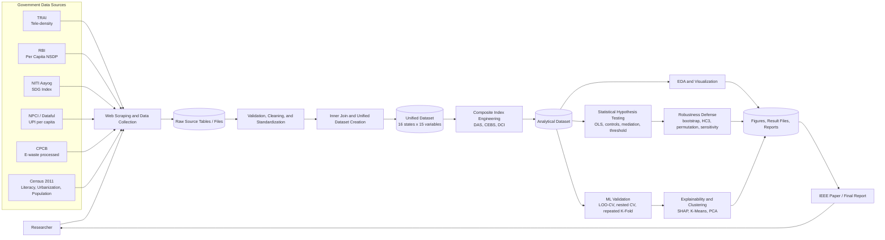
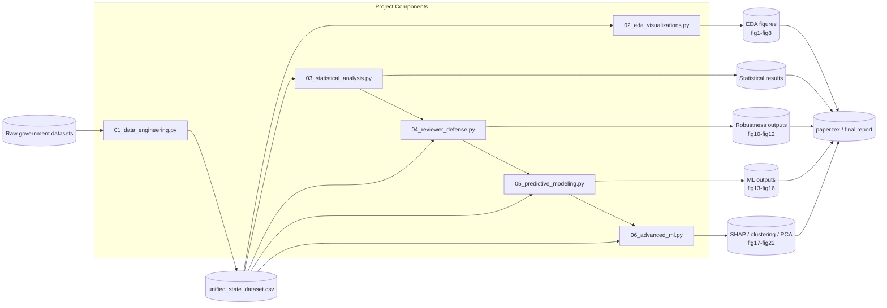
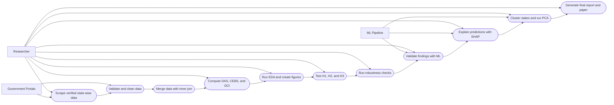
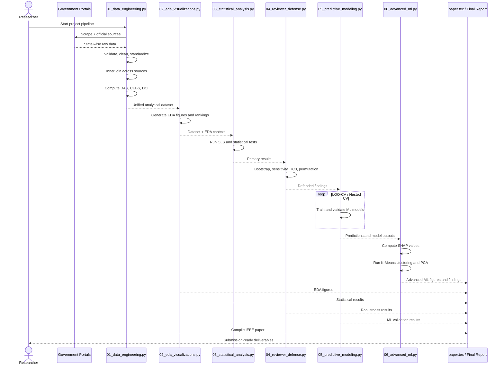
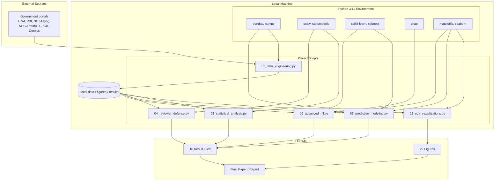
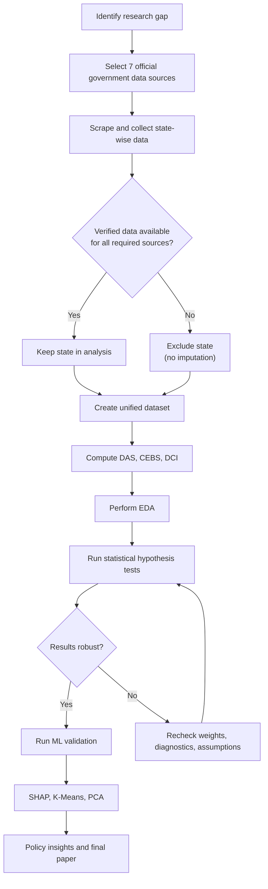

# Project Mermaid Diagrams

This file contains Mermaid code for the major system diagrams for the project:
"Digital Inclusion as a Driver of Circular Economy Behavior in India".

Note:
- Mermaid does not support native UML use case, component, or deployment diagrams.
- Those are represented here as structured `flowchart` diagrams so they remain renderable in Mermaid.

## 1. Data Flow Diagram (DFD)

## 2. Component Diagram

## 3. Use Case Diagram

## 4. Sequence Diagram

## 5. Deployment Diagram

## 6. Activity / Workflow Diagram

## Suggested Usage In Report

- Chapter on methodology: use the Data Flow Diagram and Activity Diagram.
- Chapter on system design: use the Component Diagram and Deployment Diagram.
- Chapter on execution logic: use the Sequence Diagram.
- Viva or presentation: use the Use Case Diagram for quick explanation.
